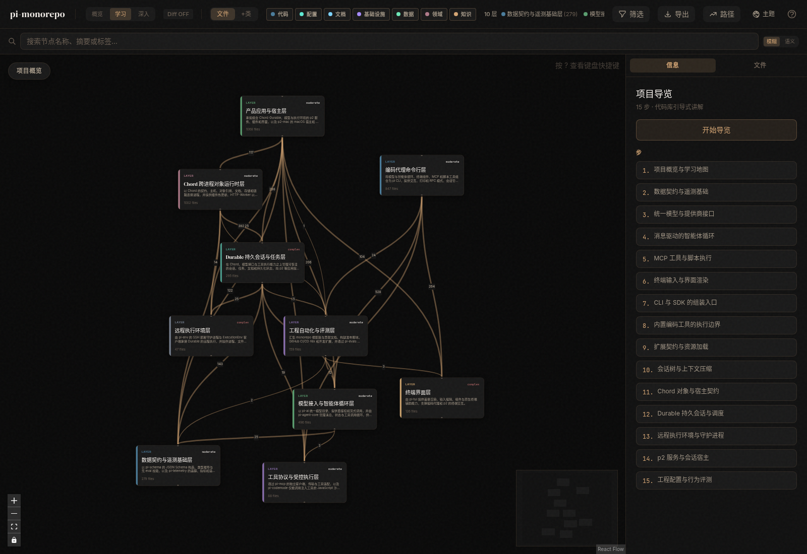
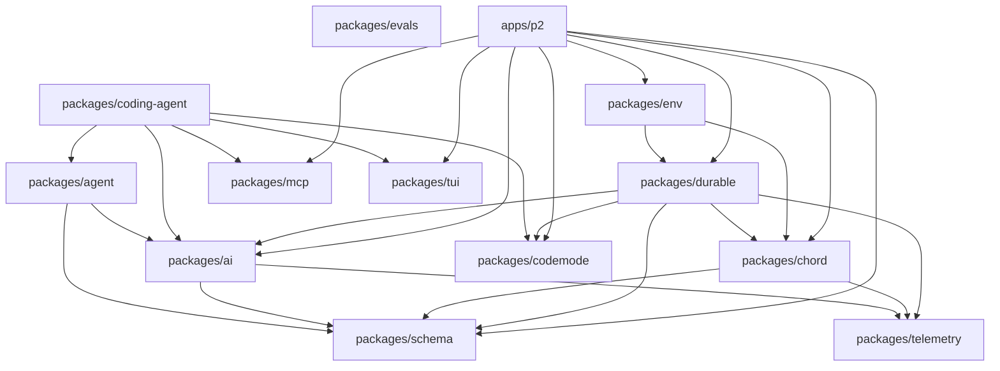

# Pi 知识图谱与学习路线

完整的开发者入门指南见 [docs/UA_ONBOARDING.md](../docs/UA_ONBOARDING.md)，包含关键概念、文件地图和复杂度热点。

实际构建与并存操作见 [Linux / Windows 源码构建与官方版本隔离手册](../study-notes/Pi_Linux_Windows_Source_Build_and_Isolation_Guide.md)，包含独立启动器、数据路径核验和官方文件前后校验。

Pi 是可扩展的智能体工具集，以 TypeScript monorepo 组织多模型 LLM 接口、通用 Agent 循环、编码 CLI、会话管理与终端界面，并提供 Chord 跨进程对象运行时、Durable 持久会话运行时、远程执行环境及 P2 应用。

分析源版本：[`6b339afc92e1`](https://github.com/AManHasNoName12138/pi/commit/6b339afc92e1dc6574f3234e1850dff36c77294b)。目标分支：`study-notes`。生成时间：2026-11-12T10:50:52.569Z。




## 浏览图谱

已安装 Understand-Anything 时，运行 `/understand-dashboard`。也可使用以下固定版本的源码方式（需要 Node.js ≥ 22、pnpm ≥ 10）；从本仓库根目录执行，打开终端输出的完整地址（包括 `?token=`）：

```bash
PI_PROJECT_DIR="$(pwd)"
git clone https://github.com/Egonex-AI/Understand-Anything.git ../understand-anything
git -C ../understand-anything checkout 532a2e97dc007104f9a1b8d11b6cc16ae7c8cd3a
pnpm --dir ../understand-anything install --frozen-lockfile --ignore-scripts
pnpm --dir ../understand-anything --filter @understand-anything/core build
GRAPH_DIR="$PI_PROJECT_DIR" pnpm --dir ../understand-anything/understand-anything-plugin/packages/dashboard exec vite --host 127.0.0.1
```

本次环境已准备好 `/workspace/understand-anything`，只需最后一条启动命令并设置 `GRAPH_DIR=/workspace/pi`。v2.9.8 的预构建 viewer 下载地址在生成时返回 HTTP 404，因此这里使用技能支持的 Vite 备用方式。建议先从架构分层或学习路线进入，再搜索文件名；图谱包含函数和类，展开全部节点会比较密集。

- [知识图谱数据](knowledge-graph.json)：交互面板的数据源。
- [分析与校验报告](analysis-report.json)：覆盖范围、审查结果和限制。
- [增量分析指纹](fingerprints.json)：覆盖全部扫描文件的基线。
- [配置](config.json)：中文输出，未启用自动更新。

## 覆盖范围与分析深度

覆盖官方扫描器按内置排除规则发现的 **4,395 个文件**，生成 **14,309 个节点、40,452 条关系、10 个架构层、15 步学习路线**。内部导入关系完整收录 14,139 条；默认忽略的文件不在本次范围内。

| 文件类别 | 数量 |
| --- | ---: |
| 代码 | 3,636 |
| 配置 | 386 |
| 基础设施 | 19 |
| 文档 | 287 |
| 脚本 | 14 |
| 页面/样式 | 53 |

| 节点类型 | 数量 |
| --- | ---: |
| `file` | 3,703 |
| `function` | 9,083 |
| `class` | 819 |
| `service` | 9 |
| `pipeline` | 22 |
| `config` | 386 |
| `document` | 287 |

| 关系类型 | 数量 |
| --- | ---: |
| `contains` | 12,069 |
| `imports` | 14,139 |
| `calls` | 4,711 |
| `exports` | 4,172 |
| `tested_by` | 4,891 |
| `documents` | 414 |
| `depends_on` | 26 |
| `configures` | 30 |

**这是语义分析部分完成的图谱。** 早前并行语义分析及重试受到额度限制，保留了 606 个文件的语义说明；其余 3,789 个文件使用官方提取结果、符号和测试名称生成结构摘要。节点字段 `summarySource` 区分 `semantic-analysis` 与 `structure`。架构分层与学习路线另经分析，不应将所有函数摘要理解为逐行人工审查。

结构摘要在交互面板中以“结构摘要：”开头，便于区分分析深度。扫描清单含本次生成的 `.ua/config.json` 分析配置，其余文件来自目标仓库。

官方解析器为 4,276 个文件提取结构；另有 119 个文件只建立文件级节点，包含部分 HTML、CSS、二进制测试夹具及原生模块等。`calls` 仅覆盖能对应到本文件符号的静态调用，无法表达完整运行时调用链；`tested_by` 依据导入、路径约定等线索建立，不代表测试执行结果。独立配置、资源、夹具等可能没有关联边（740 个孤立节点），仍可搜索访问。

## 架构分层

| 层 | 文件级节点 | 职责 |
| --- | ---: | --- |
| 数据契约与遥测基础层 | 279 | 以 pi-schema 的 JSON Schema 构造、类型推导与无 eval 校验，以及 pi-telemetry 的追踪、指标和适配器契约，为模型接口与跨进程运行时提供共同基础。 |
| 模型接入与智能体循环层 | 496 | 以 pi-ai 统一模型目录、提供商鉴权和流式调用，并由 pi-agent-core 管理消息、状态与工具调用循环，供 CLI、Durable 和应用组合使用。 |
| 工具协议与受控执行层 | 88 | 通过 pi-mcp 的独立客户端、传输与工具适配，以及 pi-codemode 仅能调用注入工具的 JavaScript 沙箱，为智能体提供可组合的工具接入与执行能力。 |
| 终端界面层 | 126 | 由 pi-tui 提供差量渲染、输入编辑、组件与原生终端辅助能力，支撑编码代理和 p2 的终端交互。 |
| Chord 跨进程对象运行时层 | 1,002 | 以 Chord 的契约、主机、对象引用、文档、存储和链路连接进程，并提供插件热更新、HTTP、Worker 以及 Web 和终端客户端的运行基础。 |
| Durable 持久会话与任务层 | 295 | 在 Chord、模型接口与工具执行能力之上管理可恢复的会话、任务、文档和持久化状态，向 p2 等应用提供 Durable 代理运行时。 |
| 远程执行环境层 | 47 | 由 pi-env 的 SSH 部署守护进程与 ExecutionEnv 客户端承接 Durable 的远程执行，并提供进程、文件和终端操作。 |
| 编码代理命令行层 | 847 | 将模型与智能体循环、终端组件、MCP 和脚本工具组合为 pi CLI，提供交互、打印和 RPC 模式、会话管理、内置编码工具及扩展机制。 |
| 产品应用与宿主层 | 1,068 | 承载组合 Chord、Durable、模型与执行环境的 p2 服务、插件和界面，以及 p2-mac 的 macOS 宿主和 p3 的设计与探索文件。 |
| 工程自动化与评测层 | 159 | 汇集 monorepo 根配置与贡献文档、构建发布脚本、GitHub CI/CD、Nix 和开发扩展，并通过 pi-evals 与容器环境执行代理行为及文档评测。 |

下图直接来自各包 `package.json` 中声明的内部运行时依赖，箭头表示“依赖于”。它用于了解包边界；文件级导入、函数与测试关系见交互图谱。



## 学习路线

### 1. 项目概览与学习地图

先读 README，建立 Pi 作为可扩展智能体框架的整体认识，并区分交互式 CLI、打印模式、RPC 与 TypeScript SDK 的使用入口。它介绍的扩展、技能、提示模板和主题说明了项目如何适应不同工作流。后续先学习模型与工具基础，再追踪编码代理，最后进入 Chord、Durable 和 p2 的应用运行时。

[README.md](../README.md)

### 2. 数据契约与遥测基础

从概览中的共享库开始，阅读 pi-schema 与 pi-telemetry 的公共入口，认识工具参数、跨进程契约和运行观测所依赖的基础接口。pi-schema 汇总 JSON Schema 构造、类型推导与校验能力，pi-telemetry 提供与供应商无关的追踪和指标契约。先建立这些概念，有助于理解后续模型接口和应用运行时如何共享数据定义与观测方式。

[packages/schema/src/index.ts](../packages/schema/src/index.ts) · [packages/telemetry/src/index.ts](../packages/telemetry/src/index.ts)

### 3. 统一模型与提供商接口

在数据契约基础上，阅读 pi-ai 的核心类型与 Models 运行时，理解模型、消息、工具、提供商选项和使用量如何表达。Models 将模型目录、凭据、鉴权与请求分派集中到统一接口，是上层选择和调用模型的重要连接点。公共入口保留无副作用的核心类型与工具函数，而提供商工厂、实现和兼容入口通过独立子路径提供。

[packages/ai/src/index.ts](../packages/ai/src/index.ts) · [packages/ai/src/types.ts](../packages/ai/src/types.ts) · [packages/ai/src/models.ts](../packages/ai/src/models.ts)

### 4. 消息驱动的智能体循环

理解模型接口后，沿 Agent 类型、底层循环和有状态 Agent 封装，观察模型输出如何进入工具执行并继续生成消息。底层循环处理流式输出、工具声明变化、顺序或并行执行、中断与事件发布，Agent 则维护消息、队列和运行生命周期。这个分工为后续 CLI 会话提供通用的执行基础。

[packages/agent/src/types.ts](../packages/agent/src/types.ts) · [packages/agent/src/agent-loop.ts](../packages/agent/src/agent-loop.ts) · [packages/agent/src/agent.ts](../packages/agent/src/agent.ts)

### 5. MCP 工具与脚本执行

有了智能体循环，再看工具能力如何从外部接入，并如何组合成脚本。MCP 客户端管理 JSON-RPC 请求与响应及工具调用，codemode 将工具 schema 转成脚本声明，并由宿主向隔离运行时注入可用工具。最后阅读 MCP 与 codemode 的组合示例，将协议接入、脚本执行和 Agent 工具循环联系起来。

[packages/mcp/src/client.ts](../packages/mcp/src/client.ts) · [packages/codemode/src/declarations.ts](../packages/codemode/src/declarations.ts) · [packages/codemode/src/runtime/host.ts](../packages/codemode/src/runtime/host.ts) · [packages/agent/examples/mcp-codemode/main.ts](../packages/agent/examples/mcp-codemode/main.ts)

### 6. 终端输入与界面渲染

掌握模型和工具执行后，补上 CLI 的交互基础：终端适配层管理输入输出与生命周期，TUI 运行基础组织焦点、输入、覆盖层和重绘。多行编辑器把光标、补全、历史和撤销转换为可渲染状态。理解这组职责后，就能在下一步区分界面交互与代理会话的运行逻辑。

[packages/tui/src/tui.ts](../packages/tui/src/tui.ts) · [packages/tui/src/terminal.ts](../packages/tui/src/terminal.ts) · [packages/tui/src/components/editor.ts](../packages/tui/src/components/editor.ts)

### 7. CLI 与 SDK 的组装入口

现在沿 cli 到 main，再到 SDK 的依赖路径，把前面认识的模型、工具和终端能力拼成可运行的编码代理。main 解析启动配置并选择 interactive、print 或 RPC 模式，createAgentSession 则组装模型运行时、资源、工具与会话管理器，供 CLI 和外部应用使用。结合 model-runtime 与 interactive-mode，观察模型服务和终端交互分别如何接入会话。

[packages/coding-agent/src/cli.ts](../packages/coding-agent/src/cli.ts) · [packages/coding-agent/src/main.ts](../packages/coding-agent/src/main.ts) · [packages/coding-agent/src/core/sdk.ts](../packages/coding-agent/src/core/sdk.ts) · [packages/coding-agent/src/core/model-runtime.ts](../packages/coding-agent/src/core/model-runtime.ts) · [packages/coding-agent/src/modes/interactive/interactive-mode.ts](../packages/coding-agent/src/modes/interactive/interactive-mode.ts)

### 8. 内置编码工具的执行边界

从 SDK 组装的工具集合继续下钻，阅读 read、write、edit 与 bash，理解模型请求怎样变成文件和进程操作。read 将文本或图像整理为模型可读结果，write 与 edit 分别处理内容写入和匹配文本修改，bash 连接执行环境、取消信号与输出收集。这一步把前面的通用工具循环落实为编码代理实际改变工作区的能力。

[packages/coding-agent/src/core/tools/read.ts](../packages/coding-agent/src/core/tools/read.ts) · [packages/coding-agent/src/core/tools/write.ts](../packages/coding-agent/src/core/tools/write.ts) · [packages/coding-agent/src/core/tools/edit.ts](../packages/coding-agent/src/core/tools/edit.ts) · [packages/coding-agent/src/core/tools/bash.ts](../packages/coding-agent/src/core/tools/bash.ts)

### 9. 扩展契约与资源加载

了解内置能力后，再看用户如何给同一会话增加行为。resource-loader 统一发现扩展、技能、提示模板、主题和项目指令文件，扩展类型定义宿主允许注册的 API 与事件，而 runner 负责执行事件处理器和命令。将资源发现、扩展契约与事件执行分开阅读，可以理解 README 中的可扩展性如何进入运行流程。

[packages/coding-agent/src/core/resource-loader.ts](../packages/coding-agent/src/core/resource-loader.ts) · [packages/coding-agent/src/core/extensions/types.ts](../packages/coding-agent/src/core/extensions/types.ts) · [packages/coding-agent/src/core/extensions/runner.ts](../packages/coding-agent/src/core/extensions/runner.ts)

### 10. 会话树与上下文压缩

在工具和扩展之上，AgentSession 协调各运行模式共享的会话生命周期，把事件持久化、消息排队、工具执行与会话导航连接起来。session-manager 保存带父子关系的历史条目，并将当前分支投影为模型上下文；压缩与分支摘要则为长历史和分支切换准备后续请求所需的上下文。这组文件说明编码代理如何把一次次模型调用组织成可恢复、可分支的工作过程。

[packages/coding-agent/src/core/agent-session.ts](../packages/coding-agent/src/core/agent-session.ts) · [packages/coding-agent/src/core/session-manager.ts](../packages/coding-agent/src/core/session-manager.ts) · [packages/coding-agent/src/core/compaction/compaction.ts](../packages/coding-agent/src/core/compaction/compaction.ts) · [packages/coding-agent/src/core/compaction/branch-summarization.ts](../packages/coding-agent/src/core/compaction/branch-summarization.ts)

### 11. Chord 对象与宿主契约

完成编码代理路线后，转向 p2 所依赖的跨进程应用基础 Chord，并重新使用第二步的数据契约概念。contracts 定义对象参数、成员、版本与主机归属，host 连接插件声明、对象实例、引用和生命周期，store 则提供存储、表与查询接口。配合被广泛引用的 context 入口，先认识对象、宿主、共享上下文和存储这些概念，为 Durable 的持久运行时建立词汇。

[packages/chord/src/contracts/index.ts](../packages/chord/src/contracts/index.ts) · [packages/chord/src/host/index.ts](../packages/chord/src/host/index.ts) · [packages/chord/src/context/index.ts](../packages/chord/src/context/index.ts) · [packages/chord/src/store/index.ts](../packages/chord/src/store/index.ts)

### 12. Durable 持久会话与调度

在 Chord、模型接口和工具能力之上，Durable 提供可恢复的会话、文档与任务运行时。先看公共入口，再对照 session 的提交和事务边界、harness 的恢复与分叉操作，以及 scheduler 的工作调度，理解持久状态如何参与代理执行。SQLite 的 Node 适配入口展示了这些会话能力连接本地数据库的位置。

[packages/durable/src/index.ts](../packages/durable/src/index.ts) · [packages/durable/src/session/session.ts](../packages/durable/src/session/session.ts) · [packages/durable/src/harness/harness.ts](../packages/durable/src/harness/harness.ts) · [packages/durable/src/harness/scheduler.ts](../packages/durable/src/harness/scheduler.ts) · [packages/durable/src/storage/sqlite/node.ts](../packages/durable/src/storage/sqlite/node.ts)

### 13. 远程执行环境与守护进程

理解 Durable 的运行方式后，阅读 pi-env 如何把文件与命令操作接到远程机器。SSH 入口负责探测、信任和 daemon 部署启动，connection 关联协议请求与响应，remote-env 将这些能力适配为 Durable 的 ExecutionEnv。再对照 Rust daemon 的请求分派入口，就能理解代理逻辑与凭据留在本地主机时，工具操作如何在远端执行。

[packages/env/src/ssh.ts](../packages/env/src/ssh.ts) · [packages/env/src/connection.ts](../packages/env/src/connection.ts) · [packages/env/src/remote-env.ts](../packages/env/src/remote-env.ts) · [packages/env/daemon/src/main.rs](../packages/env/daemon/src/main.rs)

### 14. p2 服务与会话宿主

带着 Chord、Durable 和执行环境的概念，最后进入 p2 的应用组装层。server 接受 HTTP 与 WebSocket 请求并把会话地址路由到对应 worker，worker 通过 IPC 连接服务器，并在会话的 Chord 存储上加载 Durable Harness 与插件 facet。结合公共 API 入口和 sessions 插件契约，观察共享库如何被组织为服务、会话进程与应用接口。

[apps/p2/src/hosts/server.ts](../apps/p2/src/hosts/server.ts) · [apps/p2/src/hosts/worker.ts](../apps/p2/src/hosts/worker.ts) · [apps/p2/src/api/v1/index.ts](../apps/p2/src/api/v1/index.ts) · [apps/p2/plugins/sessions/contract.ts](../apps/p2/plugins/sessions/contract.ts)

### 15. 工程配置与行为评测

完成两条运行路线后，回到根 package 配置和 CI 流程，理解 monorepo 的工作区、构建顺序、检查与交付如何支撑这些包协同演进。再看评测 harness 与 Dockerfile，认识编码代理评测入口及其依赖安装、资源准备和容器运行环境。把这些非代码配置与前面的运行模块对照，可以区分应用执行路径和工程验证路径，并找到继续学习或验证改动的位置。

[package.json](../package.json) · [.github/workflows/ci.yml](../.github/workflows/ci.yml) · [packages/evals/src/harness.ts](../packages/evals/src/harness.ts) · [packages/evals/docker/Dockerfile](../packages/evals/docker/Dockerfile)

## 生成与校验

使用 [Understand-Anything v2.9.8](https://github.com/Egonex-AI/Understand-Anything/tree/532a2e97dc007104f9a1b8d11b6cc16ae7c8cd3a) 的 [understand 技能](https://github.com/Egonex-AI/Understand-Anything/blob/532a2e97dc007104f9a1b8d11b6cc16ae7c8cd3a/understand-anything-plugin/skills/understand/SKILL.md)。流程包含官方扫描、导入提取、191 批结构提取、470 个结果分片、官方合并、组装审查、架构分析、学习路线、官方内联校验与指纹生成。对官方已列出的 TypeScript/JavaScript 类方法补充了 AST 行号，并排除了 Dockerfile heredoc 中两条被误识别为构建阶段的 Python 导入语句。

最终通过官方 `KnowledgeGraphSchema` 及文件覆盖、完整导入、端点有效性、源码行号、分层和学习路线检查。未修改应用代码，未运行应用测试。完整警告及不支持符号提取的文件列表保存在 [analysis-report.json](analysis-report.json)。

如需重新完整生成，在支持该技能的助手中运行 `/understand --full --language zh`；后续运行 `/understand` 可利用指纹与保留的扫描清单进行增量分析。`intermediate/`、`tmp/` 与清理归档均由本目录的 `.gitignore` 排除。

`.understandignore` 已排除本次生成的图谱、报告和临时文件，防止后续扫描把分析产物再次纳入图谱；原扫描包含的 `.ua/config.json` 仍保留。
